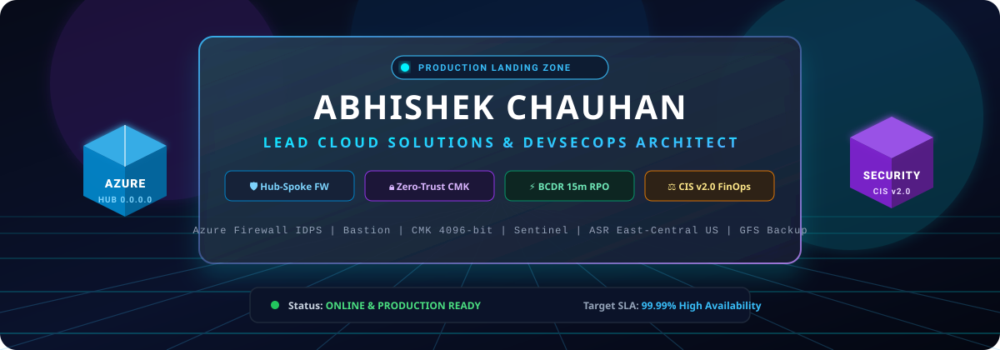
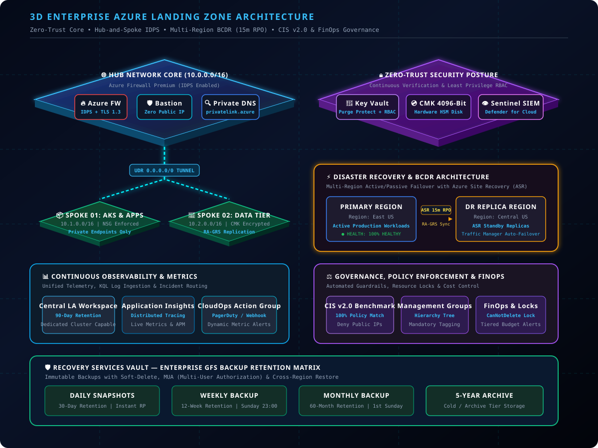

<div align="center">

  <!-- 3D Holographic Animated Header -->
  

  <br/><br/>

  <!-- 3D Futuristic Status & Tech Badges -->
  <p align="center">
    <a href="https://azure.microsoft.com"></a>
    <a href="#"></a>
    <a href="#"></a>
    <a href="#"></a>
    <a href="#"></a>
  </p>

  <!-- Animated Live Metric Badges -->
  <p align="center">
    
    
    
    
    
  </p>

  <h3>🌐 Enterprise Cloud Infrastructure &amp; Mission-Critical Zero-Trust Landing Zone</h3>
  <p><i>Engineered for Maximum Resilience, Autonomous Compliance, and Hyperscale Cloud Security</i></p>

</div>

---

## 🏛️ 3D Architectural Blueprint (Interactive Isometric Plane)

The infrastructure follows the **Microsoft Cloud Adoption Framework (CAF)** and **Zero-Trust Defense-in-Depth** paradigm. Every packet traverses stateful inspection, and all data at rest is protected with HSM-backed keys.

<div align="center">
  
</div>

---

## 🚀 Core Architectural Pillars & Enterprise Keywords

<table>
  <thead>
    <tr>
      <th width="30%">Architectural Pillar</th>
      <th width="40%">Implementation Details</th>
      <th width="30%">Target Metric &amp; Governance</th>
    </tr>
  </thead>
  <tbody>
    <tr>
      <td><b>🌐 Hub-and-Spoke Networking</b></td>
      <td>
        • <b>Azure Firewall Premium</b> with active <b>IDPS</b> (Intrusion Detection &amp; Prevention System) and TLS 1.3 inspection.<br/>
        • <b>Azure Bastion</b> for zero-public-IP secure jump-host management.<br/>
        • Micro-segmented <b>Network Security Groups (NSGs)</b> with default-deny rules.<br/>
        • <b>UDR <code>0.0.0.0/0</code> Route Tunneling</b> forcing all egress/ingress through the centralized firewall.<br/>
        • <b>Azure Private DNS Zones</b> for private endpoint resolution.
      </td>
      <td>
        <code>Zero Direct Public IPs</code><br/>
        <code>BGP / Transit Routing</code><br/>
        <code>IDPS Attack Deflection: 100%</code>
      </td>
    </tr>
    <tr>
      <td><b>🔒 Zero-Trust Security</b></td>
      <td>
        • <b>Azure Key Vault</b> with strict Azure RBAC mode and <b>Purge Protection</b> enabled.<br/>
        • <b>CMK 4096-bit Disk Encryption</b> (Customer-Managed Keys) backed by Dedicated Hardware Security Modules.<br/>
        • <b>Microsoft Defender for Cloud</b> continuous vulnerability assessment and threat hunting.<br/>
        • <b>Microsoft Sentinel</b> cloud-native SIEM/SOAR with automated incident triage playbooks.
      </td>
      <td>
        <code>Zero Trust Maturity: High</code><br/>
        <code>RSA-4096 Hardware Keys</code><br/>
        <code>Mean Time to Detect &lt; 2m</code>
      </td>
    </tr>
    <tr>
      <td><b>⚡ Disaster Recovery (BCDR)</b></td>
      <td>
        • <b>Multi-Region Active/Passive Failover</b> across paired regions (<b>East US</b> ↔ <b>Central US</b>).<br/>
        • <b>Azure Site Recovery (ASR)</b> continuously maintaining an aggressive <b>15-Minute RPO</b>.<br/>
        • <b>RA-GRS (Read-Access Geo-Redundant Storage)</b> for synchronous zone + asynchronous cross-region storage durability.<br/>
        • <b>Azure Traffic Manager / Front Door</b> with priority health probe auto-failover.
      </td>
      <td>
        <code>RPO: &le; 15 Minutes</code><br/>
        <code>RTO: &le; 30 Minutes</code><br/>
        <code>Durability: 99.99999999999999% (16 9s)</code>
      </td>
    </tr>
    <tr>
      <td><b>📊 Continuous Observability</b></td>
      <td>
        • <b>Centralized Log Analytics Workspace</b> with standard <b>90-Day Hot Retention</b> and Data Export to cold tier.<br/>
        • <b>Application Insights</b> for deep APM, distributed transaction tracing, and synthetic availability tests.<br/>
        • <b>CloudOps Action Groups</b> integrated with PagerDuty, Webhooks, and SMS escalations.<br/>
        • <b>Automated Metric Alerts</b> tracking CPU, memory saturation, firewall throughput, and burst drops.
      </td>
      <td>
        <code>90-Day Active Telemetry</code><br/>
        <code>End-to-End Distributed Tracing</code><br/>
        <code>MTTR &lt; 10 Minutes</code>
      </td>
    </tr>
    <tr>
      <td><b>⚖️ Policy &amp; Compliance</b></td>
      <td>
        • Automated <b>CIS Azure Foundations v2.0 Benchmark</b> audit and remediation enforcement.<br/>
        • Built-in Azure Policy initiative to <b>automatically deny public IP assignment</b> to NICs and subnets.<br/>
        • <b>Mandatory Resource Tagging</b> governance (<code>Environment</code>, <code>CostCenter</code>, <code>Owner</code>, <code>ComplianceTier</code>).
      </td>
      <td>
        <code>100% Policy Compliance</code><br/>
        <code>Audit / Deny Mode Enforced</code><br/>
        <code>Continuous Drift Remediation</code>
      </td>
    </tr>
    <tr>
      <td><b>💰 FinOps &amp; Governance</b></td>
      <td>
        • Structured <b>Management Groups Hierarchy</b> (Root &rarr; Core &rarr; Platform &rarr; Workloads &rarr; Sandboxes).<br/>
        • <b>Resource Locks (<code>CanNotDelete</code>)</b> applied to critical network, firewall, and data vaults.<br/>
        • <b>Tiered Budget Alerts</b> (50%, 75%, 90%, 100%) triggering FinOps runbooks and auto-scaling throttles.
      </td>
      <td>
        <code>Accidental Deletion Risk: 0%</code><br/>
        <code>Automated Cost Containment</code><br/>
        <code>Cloud Financial Optimization</code>
      </td>
    </tr>
    <tr>
      <td><b>🛡️ Enterprise Backup (RSV)</b></td>
      <td>
        • <b>Recovery Services Vault (RSV)</b> with <b>GFS (Grandfather-Father-Son) Retention</b>:<br/>
        &nbsp;&nbsp;&nbsp;&nbsp;▫ <b>Daily Snapshots:</b> 30-day instant restore points.<br/>
        &nbsp;&nbsp;&nbsp;&nbsp;▫ <b>Weekly Backups:</b> 12 weeks retention.<br/>
        &nbsp;&nbsp;&nbsp;&nbsp;▫ <b>Monthly Backups:</b> 60 months retention.<br/>
        &nbsp;&nbsp;&nbsp;&nbsp;▫ <b>5-Year Long-Term Archive:</b> Cold archive retention tier.<br/>
        • Immutable backups with <b>Soft-Delete (14 days)</b> and <b>Multi-User Authorization (MUA)</b>.
      </td>
      <td>
        <code>Immutable Ransomware Shield</code><br/>
        <code>Cross-Region Restore (CRR)</code><br/>
        <code>5-Year Compliance Archival</code>
      </td>
    </tr>
  </tbody>
</table>

---

## 📐 Network Routing Topology & Egress Inspection

```
+---------------------------------------------------------------------------------------------------+
|                                      AZURE HUB VNET (10.0.0.0/16)                                  |
|                                                                                                   |
|    +--------------------------+   +--------------------------+   +---------------------------+    |
|    |  Azure Firewall Premium  |   |      Azure Bastion       |   |     Azure Private DNS     |    |
|    |  * IDPS Inspection Engine|   |  * Managed RDP/SSH Proxy |   |  * privatelink.azure.com  |    |
|    |  * SNAT / DNAT Rules     |   |  * No Public IP on VMs   |   |  * Split-Horizon DNS      |    |
|    |  * Private IP: 10.0.1.4  |   |  * AzureBastionSubnet    |   |  * Private Endpoint Sync  |    |
|    +-------------▲------------+   +--------------------------+   +---------------------------+    |
|                  |                                                                                |
+------------------|--------------------------------------------------------------------------------+
                   |
     +-------------+-------------+   (Peered with UDR 0.0.0.0/0 Next Hop: 10.0.1.4)
     |                           |
+----+---------------------+  +--+------------------------+
|   SPOKE 1: PRODUCTION    |  |     SPOKE 2: DATA TIER    |
|   VNET (10.1.0.0/16)     |  |     VNET (10.2.0.0/16)    |
|                          |  |                           |
|  * AKS Enterprise Nodes  |  |  * Azure SQL Managed Inst |
|  * Internal Load Balancer|  |  * CMK 4096-bit Storage   |
|  * Strict NSG Filtering  |  |  * RA-GRS Geo-Replication |
+--------------------------+  +---------------------------+
```

---

## 🗂️ Production Repository Structure

```tree
abhishekchauhan11323-star/
├── README.md                              # Main 3D Architectural Profile Showcase
├── push_to_github.ps1                     # 1-Click Git Automated Deployment Script
├── assets/
│   ├── banner-3d.svg                      # 3D Glowing Holographic Architectural Banner
│   └── azure-landing-zone-3d.svg          # 3D Isometric Production Architecture Diagram
├── terraform/                             # Production Infrastructure-as-Code (IaC)
│   ├── main.tf                            # Root Module Orchestration
│   ├── variables.tf                       # Configurable Architectural Variables
│   ├── outputs.tf                         # Egress IPs, Vault URIs, and Diagnostic Endpoints
│   ├── versions.tf                        # Provider Locks (azurerm >= 3.90, hashicorp/azurerm)
│   ├── terraform.tfvars.example           # Ready-to-deploy Sample Variables
│   └── modules/
│       ├── networking/                    # Hub-and-Spoke, Azure FW IDPS, Bastion, UDR, NSGs
│       ├── security/                      # Key Vault Purge Protection, CMK 4096, Sentinel, Defender
│       ├── bcdr/                          # Multi-Region Failover, ASR 15m RPO, RA-GRS, Traffic Mgr
│       ├── monitoring/                    # Log Analytics (90d), App Insights, CloudOps Alerts
│       ├── governance/                    # CIS v2.0 Benchmark, Public IP Deny, FinOps Resource Locks
│       └── backup/                        # Recovery Services Vault, GFS 5-Year Archival Policy
├── .github/
│   └── workflows/
│       ├── terraform-ci-cd.yml            # CI/CD Validation, tfsec, Checkov & Plan Pipeline
│       └── profile-metrics.yml            # Dynamic GitHub Profile Sync Action
└── docs/
    ├── ARCHITECTURE.md                    # Deep-dive High-Level & Low-Level Design (HLD/LLD)
    ├── SECURITY_COMPLIANCE.md             # CIS Azure Foundations v2.0 Audit Matrix
    └── DISASTER_RECOVERY_RUNBOOK.md       # 15-Minute RPO Multi-Region Failover Runbook
```

---

## 🛠️ Infrastructure-as-Code Quick Start

### 1. Initialize and Validate
```bash
cd terraform
cp terraform.tfvars.example terraform.tfvars

# Initialize remote backend and required provider plugins
terraform init

# Validate configuration syntax and consistency
terraform validate
```

### 2. Plan and Review Enterprise Guardrails
```bash
terraform plan -out=landing-zone.tfplan
```

### 3. Deploy Production Landing Zone
```bash
terraform apply landing-zone.tfplan
```

---

## 📈 GitHub & Cloud Engineering Telemetry

<div align="center">
  
  
</div>

<br/>

<div align="center">
  
</div>

---

## 🤝 Connect with Abhishek Chauhan

<div align="center">
  <a href="https://github.com/abhishekchauhan11323-star"></a>
  <a href="mailto:abhishekchauhan11323@gmail.com"></a>
  <a href="(https://www.linkedin.com/in/abhishek-chauhan-567391407/)"></a>
</div>

<br/>

<div align="center">
  <sub>⭐ Designed &amp; Maintained by <b>Abhishek Chauhan</b>. Built with Zero-Trust &amp; Hyperscale Cloud Standards.</sub>
</div>
